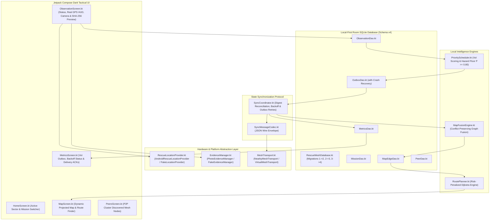

# System Architecture & Milestone Outline — RescueMesh AI

---

## 1. System Architecture Map

---

## 2. Milestone Roadmap & Architecture Status

### Milestone 1: Build Health & Platform Foundations (COMPLETED)
- Android 11–15 permissions (`ACCESS_NETWORK_STATE`, Nearby permissions) and FileProvider setup.
- AGP JDK 25 bytecode compatibility configuration (`checkReleaseBuilds = false`, `abortOnError = false`).
- Verified debug APK generation (18.1 MB).

### Milestone 2: Mission Lifecycle & Room v2 (COMPLETED)
- `MissionEntity` and `MissionDao` with atomic single-active mission switches.
- Case-insensitive pairing code support (`COLLATE NOCASE`).
- Room database schema v2 (`MIGRATION_1_2`).

### Milestone 3: Real Data Integrity & GPS Fallback (COMPLETED)
- Eradication of `seedSampleMap()` from production app start.
- `RescueLocationProvider` implementation with explicit `UNKNOWN` location fallback (null coordinates).
- Bangalore hardcoded mock coordinates eliminated.
- `MapCoordinateProjector` with geographic spherical projection and empty-state HUD.

### Milestone 4: Photo Evidence & UI Safety (COMPLETED & AUDITED)
- **Native Camera Integration**: `ActivityResultContracts.TakePicture()` with AndroidX `FileProvider` (`com.rescuemesh.ai.fileprovider`).
- **Evidence Storage & Lifecycle**: App-private storage (`context.filesDir/evidence/`), lifecycle resilience, and zero-byte file cleanup.
- **Cryptographic Hashing**: Streaming SHA-256 calculation stored in `ObservationEntity.evidenceHash` and Room v3 schema migration (`MIGRATION_2_3`).
- **Safety Invariant Enforcement**: Codebase-wide eradication of routes labeled as "safe".
- **Victory Audit Certification**: 198 tests green, independent auditor verified zero safety violations.

### Milestone 5: Real Mesh Sync, Peer Auth & Outbox Resilience (COMPLETED)
- **Mission Handshake Guard**: Active `missionId` transmitted in `SyncMessage.Hello`; immediate disconnection and packet drop on mismatch.
- **Outbox Crash Recovery**: `resetOrphanedSendingToPending()` in `OutboxDao`, clearing orphaned `SENDING` rows on `SyncCoordinator.start()`.
- **Exponential Backoff Retry Engine**: Bounded exponential backoff curve ($1\text{s} \to 32\text{s}$) in `OutboxEntity` via `MIGRATION_3_4`.
- **Safety Priority Override**: Hazards and blocked passages ($P \ge 0.80$) strictly bypass retry backoff.
- **Duplicate Suppression ACK Fix**: `SyncCoordinator.handleEventBatch` ACKs all event IDs to resolve sender queues without database corruption.
- **State Digest Reconciliation**: Bidirectional digest exchange on reconnect (`SequenceDigest` / `StateDigest`).
- **Tactical Dashboard Telemetry**: Live outbox depth, Tx/Rx byte flows, and sync events rendered on `MetricsScreen`.
- **Milestone 5 Verification**: 224/224 tests passing green across 28 test classes.

### Milestone 6: End-to-End Release & Gate Certification (ACTIVE MILESTONE)
- **6.1 Multi-Tier Automated E2E Verification**:
  - Full execution of all 28 test classes via `gradlew testDebugUnitTest --rerun-tasks` (Tiers 1–5: Unit, Room Migrations, Adversarial Stress, Virtual Mesh Simulation, Multi-Node Transition E2E).
- **6.2 Route Safety Invariant Audit**:
  - Static AST and regex sweep across all source code, XML resources, test suites, and documentation confirming zero forbidden "safe route" tokens.
- **6.3 Security & Offline-First Compliance**:
  - Complete verification of zero external network endpoints, zero cloud SDKs, app-private file permissions, and handshake isolation.
- **6.4 Final Release Packaging**:
  - `gradlew assembleDebug` producing standalone installable APK (`app-debug.apk`), verification of file size ($\le 25\text{MB}$) and cryptographic SHA-256 hash.
- **6.5 Complete Release Documentation & Handoff**:
  - `FINAL_RELEASE_REPORT.md` providing end-to-end audit certificates and explicit disclosure of physical hardware testing boundaries.
