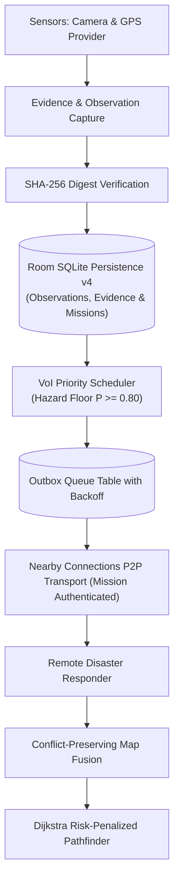

# Product Requirements Document (PRD) — RescueMesh AI
## Mission-Critical Offline Tactical Collaboration & Mesh Intelligence

---

## 1. Executive Summary
**RescueMesh AI** is an offline-first collaborative mobile intelligence platform engineered for disaster response teams operating in network-denied, subterranean, or infrastructure-collapsed environments (floods, earthquakes, structural collapses, wilderness search-and-rescue). 

Operating with **zero mandatory internet connectivity**, **zero cloud dependencies**, and **zero external server telemetry**, RescueMesh AI turns standard Android devices into an autonomous peer-to-peer ad-hoc mesh network using Google Nearby Connections (`P2P_CLUSTER`).

---

## 2. Core Operational Constraints & Invariants

| Invariant | Description | Non-Negotiable Contract |
|---|---|---|
| **I1: Strictly Offline-First** | Zero cloud APIs, remote authentication, or internet calls. | All dependencies must be strictly local and self-contained on the device. |
| **I2: Durable Local Persistence** | All events must be committed to Room SQLite before any transmission. | Zero in-memory volatile drops; surviving process death and device power loss is mandatory. |
| **I3: Conflict-Preserving Fusion** | Contradicting edge reports never overwrite past evidence. | Contradictory reports transition edge state to `CONFLICTED` and preserve full conflict history. |
| **I4: Route Safety Terminology Invariant** | Routes are NEVER described or labeled as "safe" in code, logs, or UI. | Routes are evaluated strictly by relative cost, surveyed distance, and explicit hazards/warnings. |
| **I5: Value-of-Information (VoI) Priority Floor** | Severe hazard and blocked passage events have absolute priority floor ($P \ge 0.80$). | Critical danger reports can never be suppressed by network aging or bandwidth cost penalties. |
| **I6: Ground Truth Evidence Integrity** | Zero synthetic observations, zero fabricated GPS coordinates in production. | When GPS is unavailable, coordinates must be recorded as explicit `UNKNOWN` (`null`). Photos must exist on disk and possess genuine SHA-256 digests. |

---

## 3. Critical Plan Evaluation & Correction Analysis
*(Addressing: What was wrong with the initial plan? What breaks? What was overkill? What did we miss?)*

### 3.1 What Was Wrong & What Breaks
1. **Unacknowledged Duplicates Causing Queue Stalls (Broken)**:
   - *Problem*: The initial mesh design silently dropped duplicate observation batches. However, in an ad-hoc mesh with asymmetric link drops, if the receiver silently ignores duplicates, the sender never receives an `ACK`. The sender's outbox retry count increases exponentially, stalling queue throughput and triggering unnecessary retries.
   - *Correction Applied*: `SyncCoordinator.handleEventBatch` was refactored to ALWAYS issue an `EventAck` containing all event IDs in the batch—even if the record already exists in the local database.
2. **Orphaned `SENDING` State on Process Death (Broken)**:
   - *Problem*: If Android Low-Memory Killer kills the app while an outbox payload is in-flight (`status = 'SENDING'`), those records remain trapped in `SENDING` upon restart and are never re-evaluated by the outbox scheduler.
   - *Correction Applied*: Added atomic `resetOrphanedSendingToPending()` in `OutboxDao`, executed synchronously at `SyncCoordinator.start()`.
3. **Mismatched Mission Data Leakage (Security Risk)**:
   - *Problem*: Standard Nearby Connections cluster discovery accepts all connections indiscriminately. Responders from Sector Alpha could receive Sector Bravo hazard updates without validation.
   - *Correction Applied*: Embedded active `missionId` inside `SyncMessage.Hello` handshake. Added strict handshake guard dropping connections and packet buffers immediately if `hello.missionId != activeMissionId`.

### 3.2 What Was Overkill
1. **Synthetic Background Map Seeding in Production**:
   - *Overkill*: `seedSampleMap()` was injecting mock Bangalore nodes on every clean app start. This created fake ground-truth data that conflicted with real field surveys.
   - *Correction*: Seeding was completely removed from `onCreate()` and isolated strictly to test fixtures.
2. **Monolithic Multi-Hop Flooding Without VoI Priority**:
   - *Overkill*: Flooding raw full database dumps across Bluetooth LE quickly congests 2.4 GHz bandwidth.
   - *Correction*: Digest-based reconciliation (`SequenceDigest` / `StateDigest`) requests only missing sequence deltas, prioritizing high-VoI hazards ($P \ge 0.80$) over routine telemetry.

### 3.3 What Was Missed & How It Was Corrected
1. **Cryptographic Photo Evidence Chain (Missed in early M1–M3)**:
   - Responders needed verifiable proof of blocked passages. Added native `ActivityResultContracts.TakePicture()` contract, `FileProvider` app-private storage (`filesDir/evidence/`), and streaming NIST FIPS 180-4 SHA-256 digest calculation stored in Room SQLite (`evidenceHash`).
2. **Room Database Non-Destructive Migration Chain (Missed in early drafts)**:
   - Sequential non-destructive migrations were implemented:
     - `MIGRATION_1_2`: Creates `missions` table with phonetic pairing codes.
     - `MIGRATION_2_3`: Adds `evidenceHash TEXT` to `observations` table.
     - `MIGRATION_3_4`: Adds `retryCount INTEGER` and `nextAttemptAt INTEGER` to `outbox` table.
3. **Route Safety Language Violations (Missed in initial UI prototypes)**:
   - Found traces of "Safe Route" labels and `GreenSafe` theme colors. Completely purged and replaced with tactical terminology (`StatusClear`, `StatusPassable`, relative cost, hazard warnings).

---

## 4. Key Functional Features & System Capabilities

### 4.1 Mission Lifecycle & Pairing (M2 Complete)
- Responders pair via human-readable phonetic pairing codes (e.g., `ALPHA-9`).
- Messages and evidence are isolated by `missionId`. Mismatched handshake messages are dropped immediately.

### 4.2 Field Observation & Photo Evidence (M4 Complete)
- Native camera capture via `ActivityResultContracts.TakePicture()` and AndroidX `FileProvider`.
- App-private storage in `context.filesDir/evidence/` with UUID-based naming.
- Streaming SHA-256 hash generation of raw image bytes stored in `ObservationEntity.evidenceHash`.
- Immediate deletion of 0-byte, corrupt, or cancelled captures to prevent orphaned files.

### 4.3 Topological Map Fusion & Route Planning (M3 & M4 Complete)
- Graph transitions across `UNEXPLORED`, `REPORTED_OPEN`, `VERIFIED_OPEN`, `REPORTED_BLOCKED`, and `CONFLICTED`.
- Blocked edges strictly excluded; conflicted edges incur heavy risk cost multipliers. Routes provide total surveyed distance and explicit hazard flags with zero "safe" labels.

### 4.4 Bandwidth-Constrained Mesh Sync & Telemetry (M5 Complete)
- Google Nearby Connections `P2P_CLUSTER` with mission-authenticated handshake.
- Digest-based state sync (`StateDigest` / `SequenceDigest`) requesting only missing sequences.
- Persistent outbox with exponential backoff retry loop ($1\text{s} \to 32\text{s}$) with Safety Override for hazards.
- Real-time transport telemetry tracked in `MetricsDao` and visualized on `MetricsScreen`.

### 4.5 End-to-End Verification & Release (M6 Target)
- 100% automated test coverage across unit, migration, adversarial, and simulated multi-node mesh scenarios.
- Production-ready debug APK packaging, cryptographic hashing, and complete deployment handoff.

---

## 5. Non-Functional Requirements & Performance Targets
- **APK Footprint**: $\le 25\text{MB}$ self-contained build (Current: 18.47 MB).
- **Cold Boot Time**: $\le 1.5\text{s}$ on mid-range Android 11+ devices.
- **Zero Internet Requirement**: 100% features operational in Airplane Mode.
- **Automated Test Coverage**: 224+ unit/integration tests passing 100% green across 28 test classes.
- **Physical Hardware Limitation Disclosure**: No physical camera or Nearby radio interactions are simulated or fabricated in CI. Physical testing occurs on real devices post-handoff.
