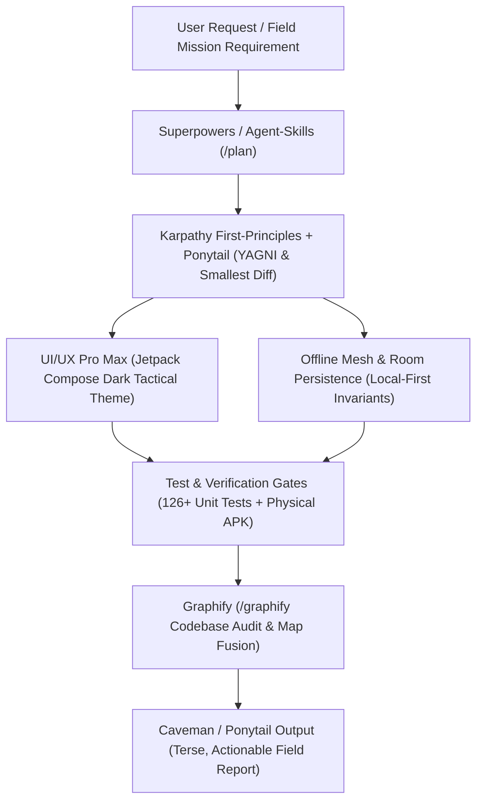

# Project Skills Registry & Operational Directives — RescueMesh AI

This document establishes the skills catalog, operational guidelines, and architectural integration for **RescueMesh AI**. All AI coding agents, worktrees, and developers operating in this repository utilize these capabilities to ensure code minimalism, tactile high-contrast UI design, token-efficient communication, and verified offline-first reliability.

---

## 1. Primary Skills Catalog

| Skill Name | Repository Source | Purpose & Role in RescueMesh AI | Installation & Activation |
|---|---|---|---|
| **Ponytail** | [`DietrichGebert/ponytail`](file:///D:/rescuemesh-ai/skills/ponytail/SKILL.md) | **Lazy Senior Developer Mode**: Minimalist diffs, YAGNI enforcement, zero code bloat, shortest working solution. Active default mode. | **Active & Wired** in `.agents/skills/ponytail`. |
| **Graphify** | [`local/.copilot/skills/graphify`](file:///D:/rescuemesh-ai/skills/graphify/SKILL.md) | **Codebase Knowledge Graph & Dependency Mapping**: Converts project files into navigable graph with community detection, God-node detection, and visual AST insights (`graphify-out/`). | **Active & Wired** in `.agents/skills/graphify`. |
| **Agent Skills** | [`addyosmani/agent-skills`](https://github.com/addyosmani/agent-skills) | **Production-Grade Engineering Workflows**: Phased SDLC workflows (`/spec`, `/plan`, `/build`, `/test`, `/review`, `/ship`), vertical slicing, and quality gates. | **Active & Wired** in `.agents/skills/` (25 skills wired). |
| **Caveman** | [`JuliusBrussee/caveman`](https://github.com/JuliusBrussee/caveman) | **Token-Efficient Concise Communication**: High-density, direct communication style ("why use many token when few token do trick"), cutting conversational overhead while preserving critical diagnostics. | **Active & Wired** in `.agents/skills/caveman*` (18 skills wired). |
| **UI/UX Pro Max** | [`nextlevelbuilder/ui-ux-pro-max-skill`](https://github.com/nextlevelbuilder/ui-ux-pro-max-skill) | **Design-Intelligence & Tactical UI Toolkit**: High-contrast, field-ready UI design system, low-light accessibility, tactile Jetpack Compose components, and design token enforcement. | **Active & Wired** in `.agents/skills/ui-ux-pro-max*` (7 skills wired). |
| **Anthropic Agent Skills** | [`anthropics/skills`](https://github.com/anthropics/skills) | **Progressive Disclosure & Specialized Agent Tools**: Reference architecture for loading domain-specific execution bundles and verification criteria on demand. | **Active & Wired** in `.agents/skills/` (19 skills wired). |
| **Karpathy Guidelines** | [`multica-ai/andrej-karpathy-skills`](https://github.com/multica-ai/andrej-karpathy-skills) | **First-Principles Coding**: Think before coding, surgical edits, avoiding premature abstractions, ground-truth verification over assumptions. | **Active & Wired** in `.agents/skills/` (11 skills wired). |
| **Matt Pocock Modular Skills** | [`mattpocock/skills`](https://github.com/mattpocock/skills) | **Composable Atomic Developer Skills**: Granular developer utilities for targeted refactoring, test composition, and modular code changes. | **Active & Wired** in `.agents/skills/` (39 skills wired). |
| **Superpowers** | [`obra/superpowers`](https://github.com/obra/superpowers) | **Autonomous Agent Lifecycle**: Structured requirements elicitation, multi-stage task decomposition, and adversarial verification harness. | **Active & Wired** in `.agents/skills/superpowers*` (15 skills wired). |

---

## 2. Skill Interoperability Matrix for RescueMesh AI



---

## 3. Detailed Skill Specifications & Guidelines

### 3.1 `ponytail` (Active Project Skill)
- **Manifest**: [`skills/ponytail/SKILL.md`](file:///D:/rescuemesh-ai/skills/ponytail/SKILL.md)
- **Core Directive**: The best code is the code never written. Solve the whole problem with the least new code.
- **Rules**:
  1. No unnecessary abstractions, wrappers, or "for later" boilerplate.
  2. Preserve all error handling, security, and offline data invariants.
  3. End every update with what was skipped/not checked and any critical operational risks.

### 3.2 `graphify` (Active Project Skill)
- **Manifest**: [`skills/graphify/SKILL.md`](file:///D:/rescuemesh-ai/skills/graphify/SKILL.md)
- **Core Directive**: Generate and query full-graph topological relationships across Kotlin, Gradle, and Room entities.
- **Key Artifacts**:
  - `graphify-out/` directory with interactive HTML graph, graph JSON, and community summaries.
  - Useful for visualizing Dijkstra routing topology in `RoutePlanner.kt` and entity relationships in Room SQLite.

### 3.3 `ui-ux-pro-max-skill` (Tactical UI Styling)
- **Application in RescueMesh AI**:
  - Emergency Dark Tactical Palette (`BackgroundDark = 0xFF0D1117`, `SurfaceDark = 0xFF161B22`, `PrimaryAmber = 0xFFFFB300`).
  - High contrast for low-visibility disaster zones (smoke, debris, direct sunlight, power outages).
  - Explicit avoidance of confusing route colors (e.g. `RedBlocked` vs `PurpleConflict`).
  - Touch target compliance ($\ge 48\text{dp}$) for gloved responders.

### 3.4 `caveman` (High-Density Status Updates)
- **Application in RescueMesh AI**:
  - Eliminates conversational pleasantries and filler tokens.
  - Formats logs, audit summaries, and git updates in concise, scannable Markdown blocks.
  - Essential for low-bandwidth telemetry transfer over emergency disaster networks.

### 3.5 `addyosmani/agent-skills` & `obra/superpowers` (SDLC Execution)
- **Application in RescueMesh AI**:
  - Enforces Verification Gates 1 through 6 before marking releases complete.
  - Governs transition from JVM test simulation to genuine Android APK validation.

---

## 4. Skills Installation & Lockfile Status

Project skill lockfile registered at [`skills-lock.json`](file:///D:/rescuemesh-ai/skills-lock.json):
```json
{
  "version": 1,
  "skills": {
    "ponytail": {
      "source": "DietrichGebert/ponytail",
      "sourceType": "github",
      "skillPath": "skills/ponytail/SKILL.md"
    },
    "graphify": {
      "source": "local/.copilot/skills/graphify",
      "sourceType": "local",
      "skillPath": "skills/graphify/SKILL.md"
    }
  }
}
```

To install additional community skills into local workspace:
```bash
npx skills add addyosmani/agent-skills
npx skills add JuliusBrussee/caveman
npx skills add nextlevelbuilder/ui-ux-pro-max-skill
npx skills add anthropics/skills
npx skills add mattpocock/skills
npx skills add obra/superpowers
```

---

## 5. Architectural Invariant Compliance
All skills configured in this repository must strictly observe the non-negotiable rules in [`AGENTS.md`](file:///D:/rescuemesh-ai/AGENTS.md):
1. **Strictly Offline-First**: Zero mandatory cloud APIs, external telemetry, or remote auth.
2. **Durable Local-First Persistence**: Commit to Room SQLite before any network transmission.
3. **Conflict-Preserving Map Fusion**: Contradicting observations mark edges `CONFLICTED` and preserve history.
4. **Safety Terminology Invariant**: Routes must NEVER be labeled as "safe".
5. **Priority Scheduling**: Urgent hazard reports enforce priority floor $P \ge 0.80$.
